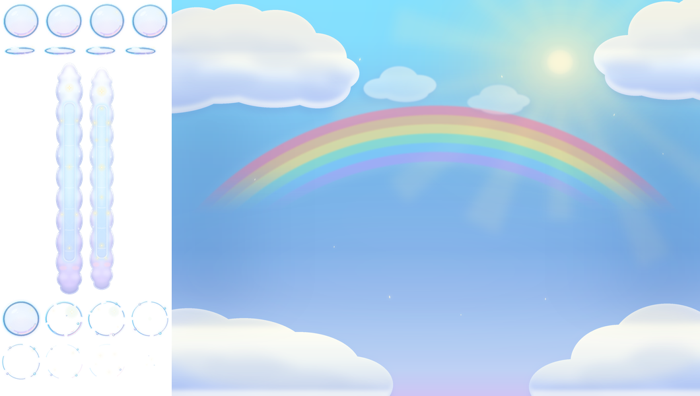

# Pingpong Art — combined background + sprite sheet

One RGBA sheet containing the complete Pingpong art set:

- **background** — one 800 × 600 fully opaque dreamy-sky scene.
- **ball-bubble** — four 64 × 64 idle bubbles and four 60 × 24 trail bubbles.
- **bubble-pop** — eight 64 × 64 burst frames that finish the ball's pop.
- **paddle-cloud** — `cloud_idle` and `cloud_hit`, each 48 × 360.

**Contrast-enhanced revision:** the mid-sky and paddle lanes are deeper blue,
the clouds carry blue-lavender shadows, and the bubble and paddle rims are
stronger.

**Bubble-pop revision:** eight 64 × 64 pop frames now occupy the formerly
empty panel at x = 0…258, y = 451…579. All eleven original frame rectangles,
their pixels and the background are unchanged.

The pack contains only the new CC0 artwork; no third-party reference assets
are included.



## Files

| File | Purpose |
| --- | --- |
| `pingpong-art.png` | Combined sheet, 1060 × 600 px, RGBA |
| `pingpong-art.spritepos` | whitespace-delimited machine-readable frames and animations |
| `pingpong-art.spritedesc` | Human-readable sheet manifest and layout notes |
| `build.py` | Self-contained deterministic Pillow renderer and packer; also writes `.spritepos` |
| `README.md` | This guide |
| `LICENSE` | CC0 1.0 Universal dedication |

## Sprite-position manifest

`pingpong-art.spritepos` is a whitespace-delimited text file. It is
intentionally simple to parse: sections in `[brackets]`, then every field on a
line is separated by spaces. Frame names use underscores, never spaces.

```ini
[meta]
version 1
texture pingpong-art.png
sheet 1060 600

[frames]
background 260 0 800 600
bubble_1 0 0 64 64
cloud_idle 81 90 48 360
pop_1 0 451 64 64

[animations]
ball.idle 8 loop bubble_1 bubble_2 bubble_3 bubble_4
ball.pop 13 once pop_1 pop_2 pop_3 pop_4 pop_5 pop_6 pop_7 pop_8
paddle.idle 8 loop cloud_idle
paddle.hit 8 once cloud_hit
```

Reading rules:

1. Skip blank lines and lines beginning with `#`.
2. A line beginning with `[` starts a section: `[meta]`, `[frames]`, or
   `[animations]`.
3. In `[frames]`, read `name x y w h` with whitespace extraction.
4. In `[animations]`, read `name fps loop|once`, then every following token is
   a frame name.
5. Frame names use underscores and never contain spaces, so a plain
   `std::stringstream` works for every line.
6. Resolve animation frame names against `[frames]` at load time; fail loudly
   if a name is missing.

The ball and paddle source rectangles in `[frames]` are unchanged from the
earlier pack; only the identifiers changed from `bubble 1` to `bubble_1`, etc.
`build.py` writes this manifest from the same frame/animation tables it uses to
render the PNG, so the PNG and manifest stay in sync.

## Sheet layout

The sheet is exactly **1060 × 600 px**, 8-bit RGBA with straight alpha. It has
four zones:

- **Original sprite block, x = 0…258, y = 0…449:** the 259 × 450 ball/paddle
  block. Its frame layout, gutters and coordinates are unchanged from the
  previous pack.
- **Bubble-pop block, x = 0…258, y = 451…579:** two rows of four 64 × 64 pop
  frames. y = 450 and y = 515 are 1 px transparent separator rows; x = 64,
  129 and 194 are 1 px transparent gutters. The strip below the pops,
  y = 580…599, is fully transparent.
- **Gutter, x = 259:** a 1 px fully transparent vertical separator.
- **Background, x = 260…1059, y = 0…599:** the 800 × 600 fully opaque
  background, pasted at its native size with no scaling.

Adjacent sprite frames are separated by 1 px transparent gutters. All areas
outside the listed frames are transparent except the background rectangle,
which is opaque throughout.

| Name | X | Y | Width | Height | Category | Use |
| --- | ---: | ---: | ---: | ---: | --- | --- |
| `background` | 260 | 0 | 800 | 600 | background | full-screen backdrop |
| `bubble_1` | 0 | 0 | 64 | 64 | ball-bubble | idle frame 0 |
| `bubble_2` | 65 | 0 | 64 | 64 | ball-bubble | idle frame 1 |
| `bubble_3` | 130 | 0 | 64 | 64 | ball-bubble | idle frame 2 |
| `bubble_4` | 195 | 0 | 64 | 64 | ball-bubble | idle frame 3 |
| `trail_1` | 0 | 65 | 60 | 24 | ball-bubble | trail frame 0 |
| `trail_2` | 61 | 65 | 60 | 24 | ball-bubble | trail frame 1 |
| `trail_3` | 122 | 65 | 60 | 24 | ball-bubble | trail frame 2 |
| `trail_4` | 183 | 65 | 60 | 24 | ball-bubble | trail frame 3 |
| `cloud_idle` | 81 | 90 | 48 | 360 | paddle-cloud | default paddle |
| `cloud_hit` | 130 | 90 | 48 | 360 | paddle-cloud | 70–110 ms rebound |
| `pop_1` | 0 | 451 | 64 | 64 | bubble-pop | swollen bubble |
| `pop_2` | 65 | 451 | 64 | 64 | bubble-pop | rim cracks |
| `pop_3` | 130 | 451 | 64 | 64 | bubble-pop | arcs + droplets |
| `pop_4` | 195 | 451 | 64 | 64 | bubble-pop | expanding ring |
| `pop_5` | 0 | 516 | 64 | 64 | bubble-pop | thin ring |
| `pop_6` | 65 | 516 | 64 | 64 | bubble-pop | dissipating ring |
| `pop_7` | 130 | 516 | 64 | 64 | bubble-pop | last droplets |
| `pop_8` | 195 | 516 | 64 | 64 | bubble-pop | sparkle residue |

Every sprite frame keeps at least 2 px of clear transparent space inside its
frame box. Sprite artwork is rendered at 4× and LANCZOS-downsampled; the
background is likewise rendered at 4× and downsampled to 800 × 600. The
background is full-bleed, so it intentionally has no transparent margin.

## Existing frame coordinates did not change

The background was appended to the right of the original sheet, so the ten
ball and paddle entries in `pingpong-art.spritepos` are unchanged:

- Bubble 1–4 remain at `(0,0)`, `(65,0)`, `(130,0)`, `(195,0)`, each 64 × 64.
- Trail 1–4 remain at `(0,65)`, `(61,65)`, `(122,65)`, `(183,65)`, each
  60 × 24.
- Cloud idle remains at `(81,90)` and cloud_hit at `(130,90)`, each 48 × 360.

Existing `asset_pos` / source-rectangle constants for the ball and paddles
**did not change**. The background line `background: 260 0 800 600` stays
first, and the eight new `pop N` lines are appended after `cloud_hit`, in play
order, without reordering or editing the original eleven lines. The eleven
original frame rectangles and their pixels are identical to the previous pack.

## background

A contrast-enhanced pastel sky with a warm sun in the upper right, a soft
rainbow crown, rounded white cloud banks at the top and bottom edges, and
sparse warm sparkles. Bright cyan (`#7FE0FF`) at the top fades through medium
periwinkle (`#78BEEA` / `#76B6E8` / `#76ADE6`) in the play band to pastel
lavender (`#C2D4F5` / `#D2C7F5`) at the base. Broad blue side bands centred on
the paddle lanes (`x ≈ 53` and `x ≈ 747`) keep those columns medium blue, and
the cloud shadows are blue-lavender rather than grey. Large bright cloud
masses stay at the top and bottom edges, away from the `y ≈ 200–400` paddle
band. The rainbow is slightly more opaque and the sun keeps its glow without
washing out the centre.

Across the 800 × 600 frame the mean background luminance is about **0.56**
(previously about **0.738**), while the top stays bright cyan and the base
stays pastel lavender. The frame is still fully opaque.

- **Source rect:** `(260, 0, 800, 600)`.
- **Destination rect:** `(0, 0, 800, 600)`, drawn at 1:1 with no scaling.
- **Anchor:** top-left `(0, 0)`; rotation `0`.
- **Draw first**, before the trails, ball, and paddles. The frame is fully
  opaque (alpha 255 on every pixel), so it clears the whole play field.

```cpp
Rectangle backgroundSrc = { 260.0f, 0.0f, 800.0f, 600.0f };
Rectangle backgroundDst = {   0.0f, 0.0f, 800.0f, 600.0f };
Vector2 backgroundOrigin = { 0.0f, 0.0f };
DrawTexturePro(sheet, backgroundSrc, backgroundDst, backgroundOrigin, 0.0f, WHITE);
```

## ball-bubble

Four idle frames show a gentle soap-bubble wobble. Four smaller, elongated
frames supply an optional trail behind the ball.

- **Idle frame:** 64 × 64 source, **26.667 × 26.667 px** destination box,
  scale **0.4167**, **center anchor**, **8 fps** loop.
- **Trail frame:** 60 × 24 source. Draw it in a 60 × 24 destination box at 1:1,
  or scale it by 0.4167 (25 × 10 px); keep the center anchor and reuse the
  same 8 fps timing or a slower decorative cadence.
- The ball's target box is the 800 × 600 game's diameter:
  `800 / 60 * 2 = 26.667 px`.

Style: translucent iridescent bubble with a luminous ice-white outer pinline,
a stronger blue inner rim, a cyan / lavender / white film, a clear luminous
centre, a top-left white highlight, a soft lower-right lavender and peach
reflection, and tiny warm-white sparkles. Palette: white `#F7FEFF`, cyan
`#8FE9FF`, aqua `#5ED6FF`, lavender `#CDB9FF`, peach `#FFD6E8`, deep inner
rim `#2E7FB8` / `#3C6FA8` / `#5E7FB8`, deep shadow `#3C7FB5`, sparkle
`#FFF6C9`. The four idle frames keep the same subtle wobble. Smooth
vector-like raster art with anti-aliased edges; no hard black outline, text,
or watermark. Composited over the background at 26.667 px, the ball's mean
composite contrast is about **1.22:1** (previously about **1.00:1**).

When the ball pops, replace the idle loop with the eight-frame `bubble-pop`
sequence described below.

## bubble-pop

Eight 64 × 64 frames continue the idle bubble's iridescent soap-film look and
carry it through a complete burst. The sequence is designed to read as broad
shapes at **32 × 32** in the 800 × 600 play field, so flashes, the broken rim
and the droplets survive the downscale.

| Frame | X | Y | Source | Start at 13 fps | Stage |
| --- | ---: | ---: | ---: | ---: | --- |
| `pop_1` | 0 | 451 | 64 × 64 | 0 ms | swollen intact bubble, bright flash / rim swell |
| `pop_2` | 65 | 451 | 64 × 64 | 77 ms | rim cracks and flashes, first arcs separate |
| `pop_3` | 130 | 451 | 64 × 64 | 154 ms | arcs pull apart, small droplets appear |
| `pop_4` | 195 | 451 | 64 × 64 | 231 ms | expanding ring, droplets move outwards |
| `pop_5` | 0 | 516 | 64 × 64 | 308 ms | thinner ring, droplets beyond the original bubble |
| `pop_6` | 65 | 516 | 64 × 64 | 385 ms | ring dissipates, more sparkles |
| `pop_7` | 130 | 516 | 64 × 64 | 462 ms | last droplets and sparkles |
| `pop_8` | 195 | 516 | 64 × 64 | 538 ms | faint sparkle residue, almost gone |

**Playback:** 64 × 64 source, **32 × 32 destination**, scale **0.5**,
**center anchor**, **12–14 fps**, **play once, then stop**. At 13 fps the full
sequence lasts **0.615 s** (8 × 76.9 ms). At the ends of the recommended range
it lasts 0.667 s at 12 fps and 0.571 s at 14 fps. Do **not** loop the pop; hide
or replace the idle ball while the sequence runs, then remove the ball.

Style: the same white / cyan / lavender iridescent film, deeper blue inner rim,
white specular highlights and warm-white sparkles as the idle bubble, with no
black outline. The frames are rendered at 4× and LANCZOS-downsampled. Every
64 × 64 box keeps at least a 2 px transparent content margin, so the effect
does not bleed into neighbouring frames.

```cpp
// Source rectangles, matching pingpong-art.spritepos.
const Rectangle kPop[8] = {
    {   0.0f, 451.0f, 64.0f, 64.0f },
    {  65.0f, 451.0f, 64.0f, 64.0f },
    { 130.0f, 451.0f, 64.0f, 64.0f },
    { 195.0f, 451.0f, 64.0f, 64.0f },
    {   0.0f, 516.0f, 64.0f, 64.0f },
    {  65.0f, 516.0f, 64.0f, 64.0f },
    { 130.0f, 516.0f, 64.0f, 64.0f },
    { 195.0f, 516.0f, 64.0f, 64.0f },
};
constexpr float kPopSize = 32.0f;  // recommended 32 x 32 game size
constexpr float kPopFps  = 13.0f;  // 12-14 fps, play once

// Start this timer once when the ball pops.
// float popStart = GetTime();
// bool  popping  = true;

if (popping) {
    int popFrame = static_cast<int>((GetTime() - popStart) * kPopFps);
    if (popFrame < 8) {
        Rectangle popDst = { popCenter.x, popCenter.y, kPopSize, kPopSize };
        Vector2 popOrigin = { kPopSize * 0.5f, kPopSize * 0.5f };
        DrawTexturePro(sheet, kPop[popFrame], popDst, popOrigin, 0.0f, WHITE);
    } else {
        popping = false;  // sequence finished; do not loop
    }
}
```

`kPopSize = 32.0f` with a half-size origin puts the pop centre exactly on
`popCenter`. Keep drawing the idle bubble untouched until the pop starts, then
suppress it for the duration of the sequence so the two do not overlap.

## paddle-cloud

A plump cloud/trampoline paddle with a taut aqua bounce bed, ice-white rim,
warm star sparkles, lavender underside, and pink blush. The two frames share
the same box, so switching between them cannot shift the layout.

- **Idle / hit frame:** 48 × 360 source, **26.667 × 200 px** destination box,
  scale **0.5556**, **center anchor**.
- Draw `cloud_idle` normally. On a collision, switch that paddle to
  `cloud_hit` for **70–110 ms** (about 4–7 frames at 60 FPS), then return to
  idle. Keep the timer per paddle.
- The paddle target box comes from `800 / 30 = 26.667 px` wide and
  `600 / 3 = 200 px` tall.

Style: one unioned cloud silhouette shared by both frames, with a 1–2 px soft
blue outline (`#5E7FB8`), a deeper blue-lavender shadow side, horizontally
symmetric, softly lit idle, and a gently compressed hit pose with a brighter
rim, inner glow, and extra sparkles. The aqua bounce bed and its pale inner
glow are slightly stronger. Palette: white `#FFFFFF`, ice `#EAF9FF`, sky
`#B9E8FF`, lavender `#D8CCFF`, blush `#FFD9EC`, warm `#FFF1B8`, shadow
`#6E8FC7`, deep outline `#5E7FB8`. The transparent safe margin is part of the
destination box, so the visible cloud sits just inside the collision box.
Composited at the 26.667 × 200 game size, idle/hit mean contrast is about
**1.89–1.95:1 / 1.95–2.01:1** (previously about **1.08–1.09:1 /
1.11–1.12:1**).

## DrawTexturePro example

```cpp
#include "raylib.h"

Texture2D sheet = LoadTexture("assets/pingpong-art/pingpong-art.png");
SetTextureFilter(sheet, TEXTURE_FILTER_BILINEAR); // soft downscaling

// Source rectangles, matching pingpong-art.spritepos.
const Rectangle kBackground = { 260.0f, 0.0f, 800.0f, 600.0f };
const Rectangle kBubble[4] = {
    {   0.0f, 0.0f, 64.0f, 64.0f },
    {  65.0f, 0.0f, 64.0f, 64.0f },
    { 130.0f, 0.0f, 64.0f, 64.0f },
    { 195.0f, 0.0f, 64.0f, 64.0f },
};
const Rectangle kTrail[4] = {
    {   0.0f, 65.0f, 60.0f, 24.0f },
    {  61.0f, 65.0f, 60.0f, 24.0f },
    { 122.0f, 65.0f, 60.0f, 24.0f },
    { 183.0f, 65.0f, 60.0f, 24.0f },
};
const Rectangle kCloudIdle = {  81.0f, 90.0f, 48.0f, 360.0f };
const Rectangle kCloudHit  = { 130.0f, 90.0f, 48.0f, 360.0f };

constexpr float kBallBox   = 26.667f; // 800 / 60 * 2
constexpr float kPaddleW   = 26.667f; // 800 / 30
constexpr float kPaddleH   = 200.0f;  // 600 / 3
constexpr float kIdleFps   = 8.0f;

// Background first, at 1:1 with a top-left anchor.
Rectangle bgDst = { 0.0f, 0.0f, 800.0f, 600.0f };
Vector2 bgOrigin = { 0.0f, 0.0f };
DrawTexturePro(sheet, kBackground, bgDst, bgOrigin, 0.0f, WHITE);

// Ball: center anchor. dst.x/dst.y are the ball centre.
int idleFrame = static_cast<int>(GetTime() * kIdleFps) % 4;
Rectangle ballDst = { ballCenter.x, ballCenter.y, kBallBox, kBallBox };
Vector2 ballOrigin = { kBallBox * 0.5f, kBallBox * 0.5f };
DrawTexturePro(sheet, kBubble[idleFrame], ballDst, ballOrigin, 0.0f, WHITE);

// Paddle: center anchor. dst.x/dst.y are the desired paddle centre.
Rectangle paddleDst = { paddleCenter.x, paddleCenter.y, kPaddleW, kPaddleH };
Vector2 paddleOrigin = { kPaddleW * 0.5f, kPaddleH * 0.5f };
Rectangle paddleSrc = isRebounding ? kCloudHit : kCloudIdle;
DrawTexturePro(sheet, paddleSrc, paddleDst, paddleOrigin, 0.0f, WHITE);

// Optional trail behind the ball:
Rectangle trailDst = { ballCenter.x, ballCenter.y, 25.0f, 10.0f };
Vector2 trailOrigin = { trailDst.width * 0.5f, trailDst.height * 0.5f };
DrawTexturePro(sheet, kTrail[idleFrame], trailDst, trailOrigin, 0.0f, WHITE);

// Later:
UnloadTexture(sheet);
```

`DrawTexturePro` offsets the destination quad by `origin`, so a half-width,
half-height origin places the selected frame's centre exactly on the
destination point. Switching between `kCloudIdle` and `kCloudHit` keeps the
same center and size. The background uses a zero origin because its destination
rect is already the full play field.

## Rebuild and source

`build.py` is the authoring source. It regenerates the background, the eight
pop frames and both original sprite categories from code and packs them into
this exact 1060 × 600 layout without reading any external image.

```sh
python3 assets/pingpong-art/build.py
```

The script writes `pingpong-art.png` and the whitespace-delimited
`pingpong-art.spritepos` next to itself using
`Path(__file__).resolve().parent`. It uses only Pillow, with no external
images, fonts, or randomness, and produces byte-stable output across runs. The
embedded renderers are deterministic: the same script regenerates the packaged
PNG byte-for-byte, and the manifest is generated from the same frame and
animation tables.

The earlier ball-bubble and paddle-cloud packs used separate build scripts.
This combined pack embeds all four deterministic renderers and composes their
frames directly. The bubble-pop renderer is appended after the original three
and writes only the eight new frame rectangles; the original eleven frames
still render to the same pixels. The contrast-enhanced revision changes only
the renderer recipes and the documentation around that fixed layout. No
layered-paint/XCF source exists.

## License

The combined sheet, background, build script, and documentation in this pack
are dedicated to the public domain under **CC0 1.0 Universal**. See
[LICENSE](LICENSE) and <https://creativecommons.org/publicdomain/zero/1.0/>.
Attribution is not required.
